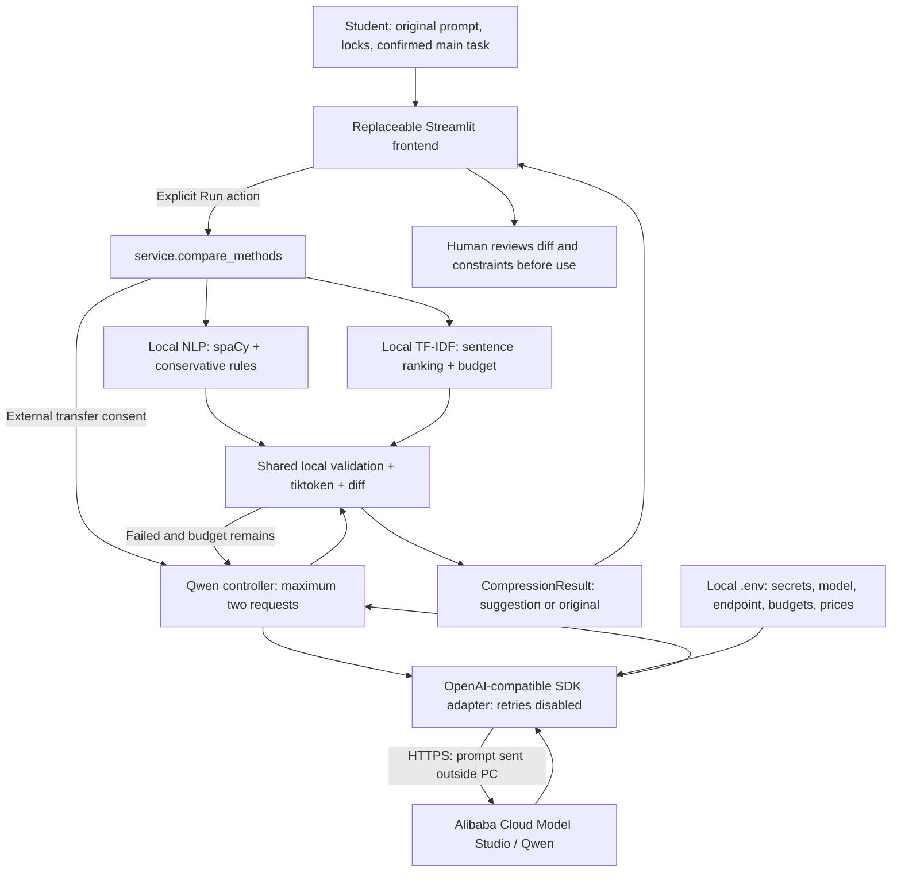

# TokenSaver architecture

Submission boundary: the app implements all three methods, but only NLP and TF-IDF have measured experimental results. Live Qwen evaluation is deferred. The frontend handoff reuses the existing Python functions and JSON-serializable result schema; no HTTP server is added. The external-provider path below describes the implemented optional integration, not a demonstrated live experiment.

The diagram's feedback edge applies only to Qwen: one initial proposal and at most one revision. Local methods validate once. The SDK performs no hidden retries. HTTP request timeouts bound individual requests; the controller also checks an elapsed-time budget before and after each request and rejects late responses. A synchronous SDK transport timeout is not a hard process-kill deadline against a faulty transport that ignores timeouts.

In the Streamlit application, only the Qwen adapter crosses the PC boundary. The other methods need installation assets (spaCy model and tokenizer cache) downloaded once, then operate offline. There is no database, file upload service or autonomous tool execution. A human must assess semantics even after a candidate passes deterministic checks.

Two later additions put the engine behind HTTP (see `FRONTEND_HANDOFF.md`). `web_api.py` (26 October 2026) serves the Tokenz website and the two local methods on 127.0.0.1, plus the AI rewrite (`optimizer/`), which sends a prompt to Groq and Google. Since 22 November 2026 the same `web_api.py` also runs in public on Render (`Dockerfile`, `../render.yaml`, `TOKENZ_PUBLIC=1`) for the GitHub Pages site. There, prompts for every method reach the Render server, and AI rewrite prompts go on to Groq and Google. Prompts are still neither logged nor stored.
