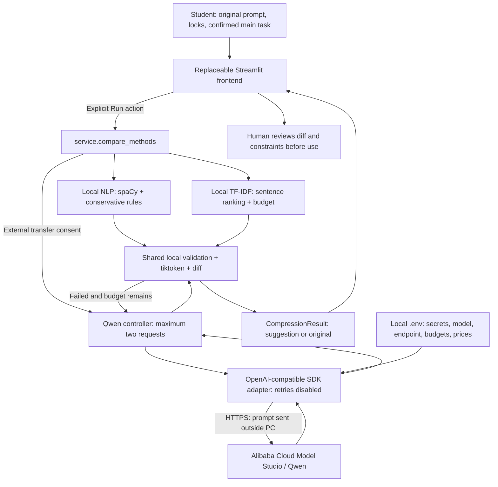

# TokenSaver architecture

Submission boundary: the app implements all three methods, but only NLP and TF-IDF have measured experimental results. Live Qwen evaluation is deferred. The frontend handoff reuses the existing Python functions and JSON-serializable result schema; no HTTP server is added. The external-provider path below describes the implemented optional integration, not a demonstrated live experiment.

The diagram's feedback edge applies only to Qwen: one initial proposal and at most one revision. Local methods validate once. The SDK performs no hidden retries. HTTP request timeouts bound individual requests; the controller also checks an elapsed-time budget before and after each request and rejects late responses. A synchronous SDK transport timeout is not a hard process-kill deadline against a faulty transport that ignores timeouts.

Only the Qwen adapter crosses the PC boundary. The other methods need installation assets (spaCy model and tokenizer cache) downloaded once, then operate offline. No database, HTTP API server, file upload service or autonomous tool execution exists. A human must assess semantics even after a candidate passes deterministic checks.
